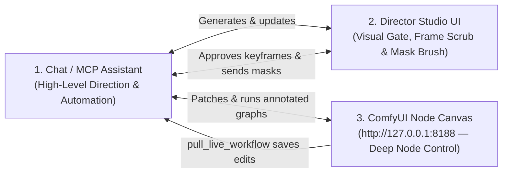
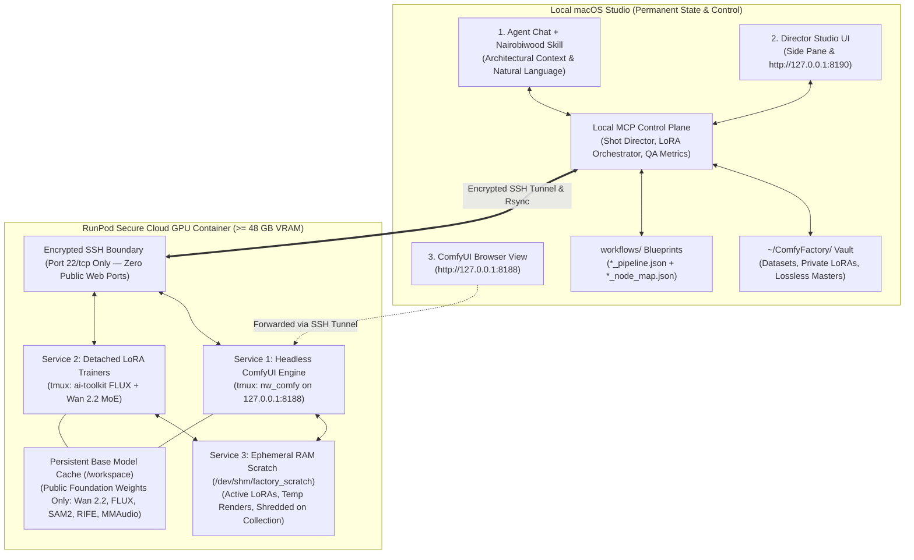

# Nairobiwood User Manual & Creative Tutorial

Welcome to **Nairobiwood** — your private AI film studio. Once the app is running, you never need to touch cloud consoles, terminals, or manual file transfers. Everything you create lives locally in `~/ComfyFactory/`, while heavy GPU rendering happens invisibly in the background.

This guide walks you through **how the three creative interfaces fit together** and **how to direct a complete multi-shot scene** from character casting to final 48 fps sound-designed export.

---

## 1. Your Three Creative Interfaces (And When to Use Each)

Nairobiwood gives you three synchronized views into the exact same project. You can stay in Chat + Director Studio 95% of the time, and open ComfyUI whenever you want to look "under the hood" or tweak advanced sampling wires.

| Interface | Where to Open It | Best Used For |
| :--- | :--- | :--- |
| **1. Chat / MCP** | Right here in your Antigravity chat | Starting/stopping your GPU session, training a new character LoRA, describing shots in plain English, chaining multi-shot handoffs, and exporting final stories. |
| **2. Director Studio** | Antigravity Side Pane (`open_director_studio`) **or** Browser at [http://127.0.0.1:8190](http://127.0.0.1:8190) | **Visual quality control:** reviewing Start/End keyframes before spending video render time, frame-by-frame scrubbing (`-10 / -1 / +1 / +10`), painting inpaint masks directly on frames, comparing `K-1 | K Raw | K Repaired` seams, and branching stories. |
| **3. ComfyUI Canvas** | Browser at [http://127.0.0.1:8188](http://127.0.0.1:8188) *(when GPU is active)* | Inspecting the annotated node graphs (complete with yellow **Markdown Note** guide cards on every pipeline), experimenting with custom samplers/LoRA weights, and pulling custom tweaks back into your studio. |

---

## 2. End-to-End Tutorial: Directing Your First Scene

### Step 1 — Wake Up the Studio & Open Director Studio
In Chat, simply say:
> *"Turn the factory on and open Director Studio."*

* Your assistant runs `factory_up` (connecting your encrypted GPU session) and `open_director_studio`.
* Check the top-left badge in **Director Studio** ([http://127.0.0.1:8190](http://127.0.0.1:8190)): it turns green when the studio GPU is live.
* *(Tip: When you finish for the day, say **"factory_down"** in Chat so your cloud GPU stops billing immediately.)*

---

### Step 2 — Cast a Character (Understanding the Two-Stage LoRA System)
Why can't a single LoRA file work everywhere? Because **still-image photography models (`FLUX`)** and **temporal 3D video models (`Wan 2.2`)** have completely different neural architectures. If you only train an image LoRA, your character looks right on Frame 0, but as soon as they turn their head or speak in the video, their facial bone structure slowly drifts toward a generic actor. Conversely, if you apply a LoRA indiscriminately across all video denoising steps, your character's body and camera movement become frozen and "statue-like."

To solve both problems simultaneously, Nairobiwood trains **two specialized, complementary LoRA files** from the exact same character dataset and saves both to `~/ComfyFactory/loras/<CharacterName>/`:

| Stage & Output File | Base Architecture Trained | Where It Plugs Into Your Workflows | Creative Role & Outcome |
| :--- | :--- | :--- | :--- |
| **Stage 1: Spatial Identity LoRA** `<Name>_flux.safetensors` | **FLUX.1-dev** (`12B` image transformer, rank 16, multi-res `512–1024px`) | • **Pipeline 1 (`wan22_keyframes`):** Start Frame (`FLUX.1-dev`) & Anchored End Frame (`FLUX.1-Kontext-dev`) • **Pipeline 3 (`wan22_frame_repair`):** Face/pose fixes (`Kontext` @ `0.85`) & hand/prop fixes (`Fill` capped `<= 0.45`) | **Photographic Likeness & Still Composition:** Locks exact bone structure, eyes, skin pores, hair, and likeness in 1280×720 still keyframes and surgical single-frame inpainting. |
| **Stage 2: Temporal Detail LoRA** `<Name>_wan22_low_noise.safetensors` | **Wan 2.2 14B I2V — Low-Noise Expert Only** (rank 32, flow-match fine-detail stage) | • **Pipeline 2 (`wan22_video_from_keyframes`):** Node `10` (MoE Pass 2, steps `12 -> 24`) • **Pipeline 4 (`wan22_frame_continue`):** Node `9` (`carry` & `pivot` tails) | **Identity Persistence in Motion:** Because Wan 2.2 splits generation into a **High-Noise Expert** (steps `0–12`: camera movement, physics, body motion — *kept LoRA-free for natural fluidity*) and a **Low-Noise Expert** (steps `12–24`: facial identity, eyes, micro-expressions), attaching Stage 2 *only* to the Low-Noise Expert keeps your actor unmistakably recognizable through head turns, lighting shifts, and emotional beats without stiffening motion. |

> [!TIP]
> **Can you start blocking shots as soon as Stage 1 finishes?** Yes! As soon as `<Name>_flux.safetensors` completes (~40 min), you can already generate, refine, and approve **Start & End Keyframes** (and even run draft I2V tests anchored by those keyframes). Once `<Name>_wan22_low_noise.safetensors` finishes, full temporal identity lock engages automatically on every video render and branch continuation.

**How to run it (in Chat):**
1. Drop **15 to 40 clear photos** of your character (varied angles, expressions, and lighting) into a folder under `~/ComfyFactory/datasets/<CharacterName>/` (or point Chat to a reference folder).
2. Tell Chat:
   > *"Train a private character LoRA for `D_Leston` with trigger word `dleston man` using `~/ComfyFactory/datasets/D_Leston`."*
3. Training runs detached in the background. Anytime you want an update, ask *"Check LoRA training status"* (or ask Chat to schedule automatic collection).
4. When complete, **Pull-and-Purge** downloads both `.safetensors` weights into `~/ComfyFactory/loras/<CharacterName>/` and `shred`s every reference photo and temp file from the remote GPU.

---

### Step 3 — Compose & Approve Start / End Keyframes (The Pre-Render Gate)
Video generation takes minutes per shot; keyframe images take seconds. Nairobiwood separates **composition** from **motion** so you never waste time animating a bad frame.

#### Option A: From Director Studio (`Start / End Keyframes` Tab)
1. Set **Project Name** (e.g., `pilot`), **Shot ID** (e.g., `shot_01`), and **Character Name** (e.g., `D_Leston`).
2. **LoRA Strength:** Keep around **`0.85`** (`0.80–0.90` gives natural skin pores and likeness).
3. **Start Keyframe Prompt:** Always include your character's trigger word + framing + lighting:
   > *"Cinematic medium close-up of dleston man standing by a rain-streaked window at dusk, warm tungsten practical lamp, 35mm film grain"*
4. **Optional — Lock End Keyframe (Kontext-Anchored):**
   Check **Lock End Keyframe** and write where the shot should land:
   > *"Same room and warm dusk lighting, dleston man turns toward the doorway with a quiet, knowing smile"*
   *(Behind the scenes, FLUX Kontext locks the room, clothes, and face from your Start Frame so the End Frame never drifts!)*
5. Click **Generate Keyframes**.

#### Option B: From Chat
> *"Generate keyframes for project `pilot`, `shot_01` with character `D_Leston`. Start: standing by a rain-streaked window at dusk. End: turning toward the doorway with a subtle smile."*

#### Refining Before You Animate
Inspect the **Start Frame** and **End Frame** side by side in Director Studio:
* **Don't like the overall pose?** Click **Re-roll Start** or **Re-roll End** to try a new seed independently.
* **Love 90% of the frame, but want to fix a hand, prop, or collar?** Click **Paint Mask & Inpaint** on either card:
  * Brush over the area you want to change.
  * Choose **FLUX Kontext** (best for face, gaze, posture) or **FLUX Fill** (best for hands, props, background objects).
  * Type a short prompt (e.g., *"relaxed left hand resting on wooden windowsill"*) and click **Apply Mask Inpaint**.

---

### Step 4 — Render the Video Shot (Wan 2.2 Dual-Expert MoE)
Once your keyframes look like still frames from a real movie:
1. In the bottom **Render Gate** card of the `Start / End Keyframes` tab:
   * Set **Duration (sec)** (e.g., `5` seconds).
   * *(Optional)* Provide a **Driving Video Path** if you want the character to mimic a real reference performance via DWPose.
   * *(Optional)* Check **Use LightX2V 4-Step Fast Distill** if you want a quick motion blocking test before doing a full-quality 24-step render.
2. Click **Approve Keyframes & Render Video** (or tell Chat: *"Approve keyframes and render `pilot/shot_01` for 5 seconds."*).

When rendering finishes, Director Studio automatically switches you to the **`Timeline Scrub, Repair & Branch`** tab with your new 24 fps clip loaded!

> **Multi-Shot Continuity Tip:** When starting `shot_02` in the exact same location, ask Chat to generate keyframes with `last_frame_handoff_shot_id="shot_01"`. Nairobiwood will extract the exact final frame of `shot_01` as the starting anchor for `shot_02`.

---

### Step 5 — Pause-and-Pivot: Scrub, Repair Frame K, and Branch
Suppose `shot_01` looks gorgeous from Frame `0` to Frame `44`, but at **Frame `45`** the character's hand warps while picking up a glass — or you decide halfway through the shot that the character should look startled instead of smiling. **You do not need to re-render Frames `0–44`!**

#### Phase 1: Scrub to the Exact Frame (`Frame K`)
1. Open the **`Timeline Scrub, Repair & Branch`** tab in Director Studio.
2. Use the video slider or the frame-exact steppers (**`-10`**, **`-1`**, **`Play / Pause`**, **`+1`**, **`+10`**) to land on the exact first frame where the issue begins (say, **Frame `45`**).

#### Phase 2: Mask & Repair Frame K (`Step 1 — Repair Frame K`)
You have two ways to tell Nairobiwood *where* on Frame `45` to operate:
* **Method A — Visual Brush Mask (Fastest & Most Precise):**
  1. Check **Paint Mask Overlay** under the video player.
  2. Adjust brush **Size** and paint red over the deformed hand or face area.
* **Method B — Automatic Text Masking (Hands-Free):**
  1. Leave the brush canvas blank and type what to isolate in **SAM2 Target Text** — e.g., `right hand holding glass`. *(Florence-2 locates it and SAM 2.1 cuts a pixel-accurate silhouette automatically.)*

Next, configure the repair:
1. **Repair Engine:**
   * Pick **FLUX Kontext** for facial identity, eyes, mouth, or head angle fixes.
   * Pick **FLUX Fill** for hands, fingers, props, or clothing artifacts.
2. **Denoise:** `0.55–0.65` for subtle fixes; `0.75–0.85` to completely rebuild a badly warped hand.
3. **Repair Prompt:** Describe the corrected region (e.g., *"natural five-fingered right hand gripping a whiskey glass, warm tungsten rim light"*).
4. Click **Extract & Repair Frame K**.

**Check the 3-Up Seam Strip:**
Director Studio displays three images side by side along with a **Seam Score** (`0.00` to `1.00`):
* **Frame `(K-1)` Seam Ref** | **Frame `K` Raw** | **Frame `K` Repaired**
* Because Nairobiwood composites *only* your feathered mask back onto raw Frame `K`, every background pixel outside your brush stays 100% identical to Frame `K-1` (typically scoring **`> 0.92`** seam continuity, meaning zero visible pop or cut!).

#### Phase 3: Continue Forward (`Step 2 — Continue Forward From Frame K`)
Once `Frame K Repaired` looks right, choose one of the three **Continuation Modes** and click **Continue From Frame K**:

| Mode | What It Does | When to Use It |
| :--- | :--- | :--- |
| **1. Carry** | Propagates your `Frame K` fix forward along the shot's original motion and prompt, then losslessly stitches `Frames 0..K-1` + `Frame K` + the new tail. | Fixing a mid-shot hand/face glitch while keeping the original acting beat. |
| **2. Pivot** | Redirects the story from `Frame K` onward using a brand-new **Continuation Prompt** (e.g., *"suddenly freezes and turns sharply toward the window"*). | Exploring alternate acting choices or story branches from the exact same opening half-shot. |
| **3. Lip-Sync** | **Fast Audio Bypass:** Keeps existing body & head motion untouched and uses **LatentSync 1.6** to synchronize the character's mouth to a `.wav` file in `~/ComfyFactory/voices/`. | Making your character speak recorded or TTS dialogue lines without re-running 14B video generation. |

Use the **Branch** dropdown at the top-right of the Timeline card anytime to switch non-destructively between the `Original Master` and every `carry`, `pivot`, or `lipsync` branch you've created!

---

### Step 6 — Assemble & Polish Your Final Story (48 fps + Foley Audio)
Once your shots (`shot_01`, `shot_02`, `shot_03`, ...) are approved, tell Chat:
> *"Compose and export the final story for project `pilot` at 48 fps with MMAudio foley: 'soft rain against glass, distant city thunder, footsteps on hardwood floor'."*

Nairobiwood runs **Pipeline 5 (`wan22_post_export`)**:
1. Concatenates your lossless 24 fps shot masters cleanly.
2. Applies **RIFE 4.26 optical-flow interpolation** (`24 -> 48 fps`) for cinema-fluid motion.
3. Runs **MMAudio Large 44.1kHz v2**, watching the video frames to synthesize frame-accurate footsteps, cloth rustle, and room ambience.
4. Saves your finished H.264 master `.mp4` locally in `~/ComfyFactory/outputs/<project>/exports/`.

---

## 3. Exploring & Customizing Workflows in the ComfyUI UX

Whenever your GPU session is active, you can open the live ComfyUI node editor in your browser at:
* **[http://127.0.0.1:8188](http://127.0.0.1:8188)**

### Built-In Visual Tour (Annotated Nodes & Yellow Guide Cards)
Every file in your local [workflows/](file:///Users/leston/code/Nairobiwood/workflows) folder has been annotated specifically for human readability inside the ComfyUI canvas:
* **Yellow `MarkdownNote` Guide Cards (`📖 READ FIRST`):** Drag and drop any `*_pipeline.json` file from [workflows/](file:///Users/leston/code/Nairobiwood/workflows) onto the ComfyUI browser window. ComfyUI automatically arranges the graph and displays formatted yellow sticky notes explaining how that pipeline works, why specific models are paired, and which sliders are safe to adjust.
* **Numbered, Self-Documenting Node Titles:** Every functional node carries a numbered title like `[19] MoE Pass 1: High-Noise Sampler (Steps 0 -> 12, Keep Noise)` or `[13] Character FLUX LoRA on Fill (Capped <= 0.45 for Anatomy)` plus a `_meta.description` field in the JSON.
* **Safe Dual Compatibility:** Those yellow `MarkdownNote` cards are visual-only UI helpers — Nairobiwood automatically strips them at submission time when running headless jobs from Chat or Director Studio.

### The 5 Annotated Studio Pipelines
1. **[wan22_keyframes_pipeline.json](file:///Users/leston/code/Nairobiwood/workflows/wan22_keyframes_pipeline.json)** — FLUX.1-dev Start Frame + FLUX.1-Kontext-dev Reference-Anchored End Frame.
2. **[wan22_video_from_keyframes_pipeline.json](file:///Users/leston/code/Nairobiwood/workflows/wan22_video_from_keyframes_pipeline.json)** — Wan 2.2 14B High-Noise -> Low-Noise MoE video render + optional DWPose/Depth Fun-Control + Dual Lossless/Preview output.
3. **[wan22_frame_repair_pipeline.json](file:///Users/leston/code/Nairobiwood/workflows/wan22_frame_repair_pipeline.json)** — Brush mask or Florence-2 + SAM 2.1 text auto-masking + Kontext/Fill repair + pixel-exact unmasked composite.
4. **[wan22_frame_continue_pipeline.json](file:///Users/leston/code/Nairobiwood/workflows/wan22_frame_continue_pipeline.json)** — `4k + 1` Wan 2.2 continuation + MKL color-grade matching + duplicate Frame-0 trim + LatentSync 1.6 dialogue lip-sync subgraph.
5. **[wan22_post_export_pipeline.json](file:///Users/leston/code/Nairobiwood/workflows/wan22_post_export_pipeline.json)** — RIFE 4.26 (`24 -> 48 fps`) frame interpolation + MMAudio 44.1kHz synchronized foley export.

### Round-Tripping Custom Node Edits Back to Chat
If you tweak a node inside ComfyUI (or want Chat to tweak a single parameter without opening the browser):
* **From ComfyUI -> Local Project:** Queue or test your tweak on the ComfyUI canvas, then tell Chat:
  > *"Pull my live ComfyUI workflow and save it as `wan22_keyframes_custom`."* (`pull_live_workflow`)
* **From Chat -> Specific Node:** Tell Chat:
  > *"Patch node `17` `denoise` to `0.75` in `wan22_frame_repair`."* (`inspect_or_patch_node`)

---

## 4. Quick Cheat Sheet: Common Prompts & Controls

| Goal | Fastest Way (Chat or Director Studio) |
| :--- | :--- |
| **Open the visual UI** | Ask Chat: *"Open Director Studio"* or visit [http://127.0.0.1:8190](http://127.0.0.1:8190) |
| **Start / stop cloud GPU** | Ask Chat: *"factory_up"* when starting; *"factory_down"* when finished |
| **See your characters & shots** | Ask Chat: *"List my local assets"* (`list_local_assets`) |
| **Fix a face / gaze / expression** | Director Studio -> **FLUX Kontext** engine, Denoise `0.55–0.65` |
| **Fix a deformed hand or prop** | Director Studio -> **FLUX Fill** engine, Denoise `0.70–0.85` |
| **Add spoken dialogue to a shot** | Place `.wav` in `~/ComfyFactory/voices/`, then use **Lip-Sync** continuation mode |
| **Inspect visual node wiring** | Drag any file from `workflows/*_pipeline.json` onto [http://127.0.0.1:8188](http://127.0.0.1:8188) |

---

## Appendix A — System Architecture & Containerized GPU Services

Even though Nairobiwood feels like a single local creative studio, it splits **creative ownership & orchestration** (on your Mac) cleanly from **ephemeral heavy compute** (inside a hardened cloud GPU container). Your private datasets, character LoRAs, workflow designs, and master renders always live on your Mac; the cloud GPU acts purely as a stateless, zero-trust compute engine.

### What Runs Inside the GPU Container?
When `factory_up` brings a GPU pod online, four isolated layers work together inside the container:

1. **Zero-Trust SSH Boundary (`22/tcp` Only):**
   The container never exposes ComfyUI (`8188`) or any HTTP port to the public internet. Every API prompt, WebSocket progress event, ComfyUI browser view, and file transfer travels exclusively through your encrypted local SSH key tunnel.
2. **Headless ComfyUI Execution Engine (`tmux: nw_comfy`):**
   Runs strictly bound to `127.0.0.1:8188` inside the container, pre-loaded with the custom node suite required for hybrid filmmaking (`WanVideoWrapper`, `VideoHelperSuite`, `Florence-2`, `SAM 2.1`, `DWPose / ControlNet-Aux`, `LatentSync 1.6`, `MMAudio`, `RIFE VFI`, and `KJNodes`). Between heavy stages (for example, switching from FLUX keyframe generation to 28B total Wan 2.2 MoE video rendering), your local MCP controller explicitly calls `/free` so 48 GB VRAM stays clean without Out-Of-Memory crashes.
3. **Detached Asynchronous LoRA Training Service (`tmux: nw_lora_*`):**
   Runs `ai-toolkit` (and `musubi-tuner` utilities) in an independent background `tmux` session. Because it is decoupled from your chat connection, long multi-stage training jobs (FLUX identity + Wan 2.2 `low_noise` expert) continue uninterrupted even if your laptop sleeps, writing live stage telemetry to `status.json`.
4. **Two-Tier Storage Separation (Public Cache vs. Ephemeral Private RAM):**
   * **Public Foundation Weights (`/workspace`):** Large public base models (FLUX, Wan 2.2, UMT5, SAM 2.1, RIFE, MMAudio) live on fast persistent container/volume storage so they don't need re-downloading.
   * **Private Creative Assets (`/dev/shm/factory_scratch`):** Your character reference photos, private `.safetensors` LoRAs, painted masks, and in-progress shot renders are staged exclusively into **RAM-backed `tmpfs` memory** (`chmod 700`) and linked into ComfyUI via `scratch/` symlinks. Under the **Pull-and-Purge** lifecycle, the moment a shot or LoRA downloads to your Mac, the remote scratch files are overwritten (`shred`) and unlinked.

---

## Appendix B — Agent-Oriented Extensibility (Evolving Pipelines Without Touching the GPU Service)

Traditional AI video tools hardcode a fixed pipeline into backend server code: changing how a shot is lit, adding a second ControlNet, or swapping an upscaler normally requires rebuilding Docker images, redeploying cloud servers, and rewriting UI forms.

Nairobiwood is intentionally inverted. **The GPU container is treated as a universal, stable box of LEGO bricks** (models + ComfyUI node classes), while **all pipeline intelligence lives locally in declarative JSON blueprints and agent skills** that your AI assistant understands natively.

### Why You Can Reshape the Pipeline Directly From Chat
Three design choices give your chat agent complete architectural visibility and safe editing power:

1. **Declarative Graph + Semantic Node Map Separation (`workflows/`):**
   Every pipeline is split into two human- and agent-readable files:
   * **`*_pipeline.json` (The Wiring):** The exact ComfyUI node graph (annotated with `_meta.title`, `_meta.description`, and `MarkdownNote` cards).
   * **`*_node_map.json` (The Contract):** A lightweight dictionary mapping high-level studio concepts (like `"positive_prompt"`, `"lora_strength"`, `"wan_frames"`) to specific `[node_id, input_key]` coordinates.
   * **Why this matters:** You or the agent can completely rewire internal nodes inside `*_pipeline.json` — insert a `ColorMatch` node, add a second style LoRA loader, swap schedulers, or insert an upscaler — and as long as `*_node_map.json` points to the right entry/exit slots, **Director Studio and every MCP tool keep working with zero backend or GPU service changes.**

2. **Full Agent Architectural Awareness (Skills + Introspection):**
   Because the agent is equipped with the **Nairobiwood Director skill**, direct access to your local `workflows/` and `infra/models_manifest.json`, and live access to ComfyUI's `/object_info` catalog (all 360+ installed node schemas and their exact input/output types over `localhost:8188`), the agent doesn't guess. You can ask in plain English:
   * *"Add a film-grain and subtle vignette post-processing node right before `VHS_VideoCombine` in `wan22_video_from_keyframes`."*
   * *"Create a variant of the keyframes workflow that loads both my character LoRA and a 1970s anamorphic lens style LoRA at 0.45 strength."*
   * *"Switch the Wan 2.2 Low-Noise sampler from `euler/simple` to `uni_pc` and run a 3-second A/B test shot."*

3. **Three Tiers of Zero-Downtime Customization:**

| What You Want to Change | How You Do It (Via Chat or ComfyUI) | Impact on Running GPU Container |
| :--- | :--- | :--- |
| **Tier 1: Tweak Sampler / Strength / Logic on a Shot** | Ask Chat to use `inspect_or_patch_node` (e.g., adjust MoE handoff step `12 -> 10`, shift `6.0 -> 5.0`, or LatentSync expression `1.5 -> 1.2`). | **Zero restart.** Applied dynamically on the very next prompt submission. |
| **Tier 2: Rewire Nodes or Build New Workflows** | Either ask Chat to edit/clone `workflows/*_pipeline.json` + `*_node_map.json`, **or** wire nodes visually on [http://127.0.0.1:8188](http://127.0.0.1:8188) and ask Chat to run `pull_live_workflow`. | **Zero restart.** The existing ComfyUI service executes the new graph topology immediately. |
| **Tier 3: Add a Brand-New Foundation Model or Custom Node Pack** | Ask Chat to append an entry to `infra/models_manifest.json` or install a custom node repo into `/workspace/nairobiwood/ComfyUI/custom_nodes`. | **Lightweight hot-reload** (or automatic inclusion on next `factory_up`) — no container image rebuild required. |

In short: **your GPU container stays boring, private, and rock-solid**, while your **creative workflows remain fluid** — co-designed between you, the ComfyUI visual canvas, and an agent that understands every wire in the studio.

